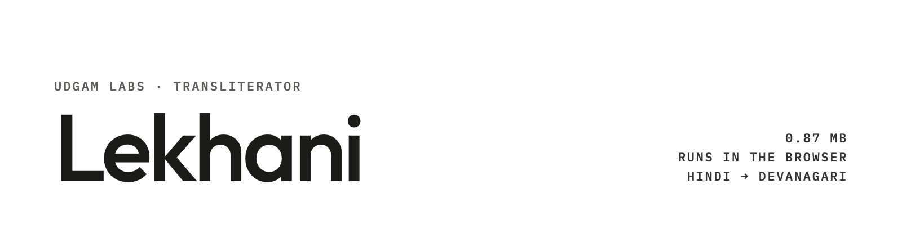

**UDGAM LABS** · Transliterator · 0.87 MB, Hindi, runs in the browser

# Lekhani

**Lekhani turns Hindi typed in Latin letters into Devanagari, on your own device.** You type `kaise ho`, it writes
कैसे हो. The whole thing is a 0.87 MB download: a 0.81M-parameter model at 4 bits, a list of 200,000 common Hindi words
and a 10 KB JavaScript runner with no dependencies. It runs in a web page or in Node, so nothing you type is sent
anywhere.

On the Aksharantar Hindi test it gets 65.9% of words exactly right, 7 points more than IndicXlit's model on its own
(58.9%), which has 14 times as many parameters. IndicXlit's full Python package is still ahead (68.7%): it re-ranks with
a 4.2-million-word list that takes 358 MB of memory, about 400 times the size of all of Lekhani.

*Lekhani* (लेखनी) is Hindi for "pen".

[Try it in your browser](https://udgamlabs.com/models/lekhani#try) · [Model card](https://huggingface.co/udgamlabs/Lekhani) · [udgamlabs.com](https://udgamlabs.com)

| | |
|---|---|
| Developer | Udgam Labs |
| Model | Encoder-decoder transformer, 2 + 2 layers, width 128, 811,904 parameters, 4-bit weights, trained from random weights |
| Files | `files/`: five files, 876,261 bytes in all (gzip) |
| Input / output | Hindi in Latin letters → Devanagari, one word at a time; everything that is not Latin letters is kept as it is |
| Runtime | JavaScript (ES module) with WebAssembly SIMD where the browser has it, plain JavaScript otherwise: any modern browser, or Node 18+. No server, no WebGPU, no dependencies |
| Licence | Apache-2.0 (model and runner); CC0 (word list) |

## Get started

**In a web page.** Serve the repository from any static host and open the example:

```bash
git clone https://github.com/udgamlabs/lekhani && cd lekhani
python3 -m http.server 8000      # or any static server
# open http://localhost:8000/examples/browser/
```

Or add it to your own page: copy the five files from `files/` next to it.

```html
<textarea id="in" placeholder="kaise ho"></textarea>
<p id="out"></p>
<script type="module">
  import { Transliterator } from "./translit.js";
  const tr = await Transliterator.load({
    model: "model.q4.gz", json: "model.json.gz", words: "words.bin.gz", rerank: "rerank.json",
  });
  const box = document.getElementById("in");
  box.addEventListener("input", () => {
    document.getElementById("out").textContent = tr.text(box.value);   // "kaise ho" → "कैसे हो"
  });
</script>
```

**In Node 18 or newer:**

```bash
node examples/node/transliterate.mjs "aaj office mein meeting hai"
# आज ऑफिस में मीटिंग है
```

```js
import fs from "node:fs";
import { Transliterator } from "./files/translit.js";

const tr = await Transliterator.load({
  model: fs.readFileSync("files/model.q4.gz"), json: fs.readFileSync("files/model.json.gz"),
  words: fs.readFileSync("files/words.bin.gz"), rerank: JSON.parse(fs.readFileSync("files/rerank.json", "utf8")),
});
console.log(tr.text("kya haal hai bhai"));                                // क्या हाल है भाई
console.log(tr.word("main").candidates.slice(0, 3).map((c) => c.text));   // [ 'में', 'मैं', 'मैन' ]
```

- `tr.text(s)` writes every run of Latin letters in Devanagari and keeps everything else (spaces, digits,
  punctuation, Devanagari) as it is.
- `tr.word(w)` returns `best` and `candidates`: the 8 spellings the model considered, best first, each with `inList`
  (whether it is one of the 200,000 listed words). Show the runners-up as suggestions if you build a keyboard.

| File | What it is | Size (gzip) |
|---|---|---|
| `files/model.q4.gz` | the model, 811,904 parameters at 4 bits | 432,512 bytes |
| `files/words.bin.gz` | 200,000 common Hindi words in 8 frequency bands | 432,193 bytes |
| `files/translit.js` | the runner (29.5 KB as written) | 10,308 bytes |
| `files/model.json.gz`, `files/rerank.json` | settings and alphabet | 1,248 bytes |
| **Total download** | | **876,261 bytes (0.88 MB)** |

Check the files with `cd files && shasum -a 256 -c ../SHA256SUMS`. The same files are on
[Hugging Face](https://huggingface.co/udgamlabs/Lekhani).

Speed in a browser, on an Intel Core i5-11300H laptop (headless Chrome 156 and Firefox 157): it starts in 0.15 s once
the files are downloaded and takes 2.4 to 2.8 ms a word on everyday words and 5.6 to 6.0 ms on the Aksharantar test
words; the previous runner took 25 to 33 ms and 53 to 63 ms on the same machine. Where WebAssembly SIMD is missing it
runs in plain JavaScript, about six times slower. The previous runner's figures on a Mac mini (Chromium: 18 ms a word,
about 23 MB of memory) have not been measured again with this one.

## Results

**Aksharantar Hindi test** (AI4Bharat): 9,991 romanised words, top-1 exact match against any reference spelling,
scored word by word with one script on the same words for every system; 95% intervals from 2,000 bootstrap resamples,
paired for gaps. Measured by us on 28 October 2026.

| System | What you download or hold | Aksharantar Hindi | Hinglish chat set (of 122) |
|---|---|---|---|
| **Lekhani** | **0.87 MB** | **65.9%** (64.9 to 66.8) | **112** |
| IndicXlit, model on its own (beam 4, its default) | 11.5M parameters (46 MB fp32; a third-party 8-bit browser export is 14.4 MB) | 58.9% | 102 |
| IndicXlit, full Python package (model + word list) | the model + a 4.2M-word list, 358 MB in memory | 68.7% | 112 |

- **Against IndicXlit's model on its own: +7.0 points** (paired 95% interval +6.1 to +8.0).
- **Against IndicXlit's full package: -2.8 points** (-3.6 to -2.1). The package is more accurate if you can afford its
  word list.
- **Hinglish chat set:** 122 words people type in chat (everyday words, English words used in Hindi, brands, names),
  written by us and checked word by word by a native Hindi speaker. Lekhani gets 112, level with IndicXlit's package.
  The set is too small to call a few words' difference.
- **Other open transliterators** we ran on the same test, word by word, scored far lower: IB-Emper
  hindi-translit-v3 (15M parameters, its model on its own) 48.6%, UnimeType Transliteration 4B 24.6% (v1.0) and
  20.0% (v2.0, released 28 Oct 2026, on a fixed 2,000-word sample), indic-xlit-270M 21.7%, indic-xlit-50M 14.8%,
  romanized-hindi-transliterator-60M 9.1%, UnimeType 2.0 0.8B 8.0%, rule-based typing schemes 5-12%. UnimeType's
  models are built for whole sentences, so their numbers are word-level results only.
- The browser runner gives the same answer and the same 8 candidates as our Python reference on all 9,991 test words.
  The current runner was checked against the previous one on the same words, with and without WebAssembly SIMD: the
  same answer and the same 8 candidates in the same order on every word, scores within 0.000002.

## Where it falls short

- **About one word in three on this test is wrong at top-1.** The test is hard: many rare words and names. On
  everyday chat words it does much better (41 of 44 in our chat set), but it still makes mistakes there.
- **Some common words come out wrong:** `acha` → अच् (should be अच्छा; `accha` works), `kal` → काल (कल is its second
  choice), `delhi` → देल्ही (should be दिल्ली).
- **No sentence context.** It writes one word at a time, so `main` ("I") and `mein` ("in") both become में:
  `main ghar ja raha hoon` → में घर जा रहा हूं (should be मैं).
- **IndicXlit's full package is 2.8 points more accurate** on the main test.
- **Hindi only**, Latin to Devanagari only.
- **Speed was measured on one Mac mini.** Phones and older laptops are not measured yet.

## How it was trained

A small encoder-decoder transformer (811,904 parameters), trained from random weights on about 4.3 million pairs of
romanised and Devanagari Hindi words, and stored at 4 bits. The pairs come from Aksharantar (its CC0 and CC-BY parts;
not its share-alike part) and from a teacher: IndicXlit wrote the many ways people type common Hindi words from
IndicCorp v2, and the Hindi spellings of English words. At run time the model proposes 8 spellings and the
200,000-word list, built from IndicCorp v2 word counts, moves a common real word up when the model is unsure. Words
that are not in the list still work from the model alone. No test word was in the training pairs.

## Intended use and limitations

For typing Hindi in Latin letters on websites, apps and tools: search boxes, forms, chat, notes, a keyboard's
suggestions. It works one word at a time and does not translate. Show users the runners-up so they can fix a wrong
word, and keep their own spelling if they do. It is not meant for names on legal or official documents without a
human check.

## Licence

Model weights and `files/translit.js`: Apache-2.0 (`LICENSE`). The word list (`files/words.bin.gz`): CC0. See `NOTICE`
for the credits: Aksharantar (AI4Bharat; CC-BY hand-collected part, CC0 mined parts), IndicXlit (AI4Bharat, MIT) as the
teacher, IndicCorp v2 (AI4Bharat, CC0) for the word counts, and the CMU Pronouncing Dictionary (BSD-style) for English
words.

## Citation

```bibtex
@misc{udgamlabs2026lekhani,
  title  = {Lekhani: a 0.87 MB in-browser Hindi transliterator},
  author = {Prasad, Jitesh K},
  year   = {2026},
  howpublished = {Udgam Labs},
  url    = {https://huggingface.co/udgamlabs/Lekhani}
}
```

Please also cite Aksharantar (Madhani et al., 2022, arXiv:2205.03018), whose data and IndicXlit model made this
possible.

---

**About Udgam Labs.** Udgam Labs is an independent AI research lab. We work from first principles: before we build, we understand why things work, whether we are training a model, fine-tuning one or applying AI to a new problem. Udgam (उद्गम) is Sanskrit for origin. [udgamlabs.com](https://udgamlabs.com)
