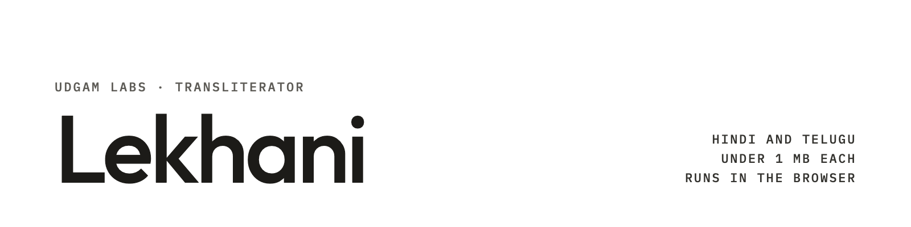

**UDGAM LABS** · Transliterator · Hindi, Kannada, Tamil and Telugu, under 1 MB each, runs in the browser

# Lekhani

Lekhani turns words typed in Latin letters into their own script: `kaise ho` becomes कैसे हो in Hindi, `naale
sigona` becomes ನಾಳೆ ಸಿಗೋಣ in Kannada, `eppadi irukkeenga` becomes எப்படி இருக்கீங்க in Tamil, `ela unnaru` becomes
ఎలా ఉన్నారు in Telugu. It covers Hindi, Kannada, Tamil and Telugu. Each language is one small model (0.8M or 1.2M parameters at 4 bits) and a list of common words,
and everything a page loads for one language, runner included, is under 1 MB. It runs in a web page on your own
device, so nothing you type is sent anywhere.

On the Aksharantar test it gets the first guess right on 79.4% of Kannada words, 74.2% of Tamil words, 81.2% of
Telugu words and 65.9% of Hindi words, ahead of IndicXlit's model on its own by 6.7, 10.0, 8.5 and 7.0 points. In Tamil
and Telugu it is level with IndicXlit's full Python package, which re-ranks with a word list of millions of words held
in memory; in Hindi and Kannada the package is ahead.

*Lekhani* (लेखनी) is Hindi for "pen".

[Try it in your browser](https://huggingface.co/spaces/udgamlabs/Lekhani) · [Model card](https://huggingface.co/udgamlabs/Lekhani) · [udgamlabs.com](https://udgamlabs.com/models/lekhani)

| | |
|---|---|
| Developer | Udgam Labs |
| Models | One per language: encoder-decoder transformer, width 128, 2 + 2 layers (0.81M parameters) or 3 + 3 layers (1.2M), 4-bit weights, trained from random weights |
| Files | `files/`: one runner, `translit.js`, and four files per language (Hindi at the root of `files/`, Kannada in `kannada/`, Tamil in `tamil/`, Telugu in `telugu/`); 0.87 MB (Hindi), 0.98 MB (Kannada), 0.71 MB (Tamil) and 0.96 MB (Telugu) in all (gzip) |
| Input / output | Latin letters → the language's script, one word at a time; everything that is not Latin letters is kept as it is |
| Runtime | JavaScript (ES module) with WebAssembly SIMD where the browser has it, plain JavaScript otherwise: any modern browser, or Node 18+. No server, no WebGPU, no dependencies |
| Licence | Apache-2.0 (models and runner); CC0 (word lists) |

## Get started

**In a web page.** Serve the repository from any static host and open the example, which has a language picker:

```bash
git clone https://github.com/udgamlabs/lekhani && cd lekhani
python3 -m http.server 8000      # or any static server
# open http://localhost:8000/examples/browser/
```

Or add it to your own page: copy `files/translit.js` and your language's four files next to it.

| Language | Folder in `files/` | Script |
|---|---|---|
| Hindi | (root) | Devanagari |
| Kannada | `kannada/` | Kannada |
| Tamil | `tamil/` | Tamil |
| Telugu | `telugu/` | Telugu |

```html
<input id="in" placeholder="naale sigona">
<p id="out" lang="kn"></p>
<script type="module">
  import { Transliterator } from "./translit.js";
  const dir = "kannada/";   // "" for Hindi, "tamil/" for Tamil, "telugu/" for Telugu
  const tr = await Transliterator.load({
    model: dir + "model.q4.gz", json: dir + "model.json.gz", words: dir + "words.bin.gz", rerank: dir + "rerank.json",
  });
  const box = document.getElementById("in");
  box.addEventListener("input", () => {
    document.getElementById("out").textContent = tr.text(box.value);
  });
</script>
```

**In Node 18 or newer:**

```bash
node examples/node/transliterate.mjs "aaj office mein meeting hai"     # Hindi: आज ऑफिस में मीटिंग है
node examples/node/transliterate.mjs --lang kannada "naale sigona"      # ನಾಳೆ ಸಿಗೋಣ
node examples/node/transliterate.mjs --lang tamil "eppadi irukkeenga"   # எப்படி இருக்கீங்க
node examples/node/transliterate.mjs --lang telugu "meeru ela unnaru"   # మీరు ఎలా ఉన్నారు
```

- `tr.text(s)` writes every run of Latin letters in the language's script and keeps everything else (spaces, digits,
  punctuation, text already in the script) as it is.
- `tr.word(w)` returns `best` and `candidates`: the 8 spellings the model considered, best first, each with `inList`
  (whether it is one of the listed common words). Show the runners-up as suggestions if you build a keyboard.
- Nothing per language goes in the call: each folder's `rerank.json` tells the runner which script its word list uses.
- `translit.js` is a minified build; `translit.src.js` is the same code, readable, with comments.
- Load several languages on one page by calling `Transliterator.load` once per language.

Check the files with `cd files && shasum -a 256 -c ../SHA256SUMS`. The same files are on
[Hugging Face](https://huggingface.co/udgamlabs/Lekhani).

## Results

**Aksharantar test** (AI4Bharat), one language at a time: every romanised word in the test, top-1 exact match against
any reference spelling, the same words and the same scorer for every system. 95% intervals from 2,000 bootstrap
resamples, paired for gaps. Each language's settings were chosen on the validation set and the test was scored once.
Measured by us between 28 October and 4 November 2026, and re-scored with the 1.3.0 runner on 11 November: the same
first guess as the scored predictions on every test word.

| Language | Test words | **Lekhani**, first guess right | IndicXlit's model on its own | Gap (paired 95% interval) | IndicXlit's full package | Download, gzip bytes |
|---|---:|---:|---:|---:|---:|---:|
| Hindi | 9,991 | **65.9%** (64.9 to 66.8) | 58.9% | **+7.0** (+6.1 to +8.0) | 68.7% | 872,565 |
| Kannada | 11,165 | **79.4%** (78.7 to 80.2) | 72.7% | **+6.7** (+6.0 to +7.4) | 80.9% | 981,214 |
| Tamil | 11,405 | **74.2%** (73.4 to 75.1) | 64.2% | **+10.0** (+9.3 to +10.7) | 73.9% | 708,999 |
| Telugu | 9,936 | **81.2%** (80.5 to 81.9) | 72.6% | **+8.5** (+7.7 to +9.3) | 81.1% | 964,906 |

- **IndicXlit's model on its own** (11.5M parameters, beam 4, its default) is the comparison we set for every language
  before training. Lekhani is ahead of it in all four, and the paired intervals are well clear of zero.
- **IndicXlit's full package** adds a word list of millions of words for each language (for Hindi, 4.2 million words,
  358 MB in memory) and re-ranks with it. Against the package Lekhani is level in Tamil (+0.3) and Telugu
  (+0.1), intervals that include zero, and behind in Hindi (-2.8) and Kannada (-1.4).
- **Download** is every file a page loads for that language, as gzip bytes: the model, its word list, the two small
  settings files and the runner (6,625 bytes). Each is under 1,000,000: Hindi 0.87 MB, Kannada 0.98 MB, Tamil 0.71 MB, Telugu
  0.96 MB.
- In Hindi, our own 122-word chat set (everyday chat words, English words used in Hindi, brands and names, checked
  word by word by a native speaker): Lekhani 113, IndicXlit's package 112, IndicXlit's model 102.

## Where it falls short

- **Names are weak, most of all in Tamil.** Aksharantar's name rows (AK-NEF and AK-NEI) get 40% and 44% right at
  top-1 in Tamil (level with IndicXlit's model there), 55% and 51% in Kannada and 58% and 59% in Telugu, against 81%,
  88% and 87% on the Dakshina rows (words as people type them).
- **IndicXlit's full package, with its multi-million-word lists, is level in Tamil and Telugu and ahead in Hindi and
  Kannada** on this test. On our real-typing checks (4,000 words each from Dakshina's romanised sentences) Lekhani gets
  76.2% in Kannada, 64.0% in Tamil and 72.4% in Telugu, ahead of IndicXlit's model (+1.5, +6.3 and +3.2) but behind its
  package (-3.8, -2.8 and -3.3). If you can hold its word lists in memory, the package is the
  more accurate choice there.
- **No native-speaker review of the misses yet**, except for Hindi's chat set. Some misses may be acceptable spellings
  that are missing from the test's answer lists; some may be real errors a native reader would catch at once.
- **No sentence context.** It writes one word at a time, so words spelled alike in Latin letters get the same output:
  in Hindi, `main` ("I") and `mein` ("in") both become में.
- **Some common words come out wrong.** In Hindi, `kal` → काल (कल is its second choice) and `delhi` → देल्ही (should
  be दिल्ली).
- **One direction only**: Latin letters to each script. It does not translate.
- **Speed was measured on one Mac mini** (2 to 4 ms a word in Node with WebAssembly SIMD). Phones and older laptops are
  not measured yet.

## How it was trained

Each language has its own small encoder-decoder transformer (2 + 2 layers, 0.81M parameters, or 3 + 3 layers, 1.2M
parameters; the size was chosen on validation), trained from random weights and stored at 4 bits. The training pairs
of romanised and native words come from Aksharantar (its CC0 and CC-BY parts; not its share-alike part) and from a
teacher: IndicXlit wrote the ways people type common words from IndicCorp v2, and each language's spellings of English
words. At run time the model proposes 8 spellings and a list of 125,000 to 250,000 common words, built from IndicCorp v2
word counts, moves a common real word up when the model is unsure. Words that are not in the list still work from the
model alone. No test or validation word was in the training pairs.

## Intended use and limitations

For typing these languages in Latin letters on websites, apps and tools: search boxes, forms, chat, notes, a
keyboard's suggestions. It works one word at a time and does not translate. Show users the runners-up so they can fix
a wrong word, and keep their own spelling if they do. It is not meant for names on legal or official documents without
a human check.

## Changes

- **Kannada (13 Nov 2026):** Kannada, in `kannada/`. The runner (1.3.0) and the Hindi, Tamil and Telugu files are
  unchanged.
- **Tamil (12 Nov 2026):** Tamil, in `tamil/`. The runner (1.3.0) and the Hindi and Telugu files are unchanged.
- **1.3.0 (11 Nov 2026):** Telugu, in its own folder. One runner serves both languages: a language's `rerank.json` now
  names the first letter of its script's block, so its word list can pack any script. Hindi is unchanged:
  the same files, and the same best word, the same 8 candidates and the same scores on all 9,991 Aksharantar Hindi test
  words as 1.2.0. `translit.js` is now a minified build (6.6 KB gzip, was 10.9 KB), with the readable source as
  `translit.src.js`.
- **1.2.0 (4 Nov 2026):** common Hindi words cut short are fixed (`acha` and `achha` now give अच्छा). Test score
  unchanged at 65.9%; the Hinglish chat set rises from 112 to 113.
- **1.1.0 (2 Nov 2026):** the runner is about 10 times faster (batched beam search, WebAssembly SIMD kernels with a
  plain-JavaScript fallback, a GELU table, leaner beam search and a 2,000-word cache), contributed by Manit Roy
  ([GitHub #1](https://github.com/udgamlabs/lekhani/pull/1)).
- **1.0.0 (30 Oct 2026):** first release, Hindi.

## Licence

Model weights and the runner (`translit.js`, `translit.src.js`): Apache-2.0. The word lists (`words.bin.gz`): CC0. See
`NOTICE` for the credits: Aksharantar (AI4Bharat; CC-BY hand-collected part, CC0 mined parts), IndicXlit (AI4Bharat,
MIT) as the teacher, IndicCorp v2 (AI4Bharat, CC0) for the word counts, and the CMU Pronouncing Dictionary
(BSD-style) for English words.

## Citation

```bibtex
@misc{udgamlabs2026lekhani,
  title  = {Lekhani: in-browser transliteration, under 1 MB per language},
  author = {Prasad, Jitesh K},
  year   = {2026},
  howpublished = {Udgam Labs},
  url    = {https://huggingface.co/udgamlabs/Lekhani}
}
```

Please also cite Aksharantar (Madhani et al., 2022, arXiv:2205.03018), whose data and IndicXlit model made this
possible.

---

**About Udgam Labs.** Udgam Labs is an independent AI research lab. We work from first principles: before we build, we understand why things work, whether we are training a model, fine-tuning one or applying AI to a new problem. Udgam (उद्गम) is Sanskrit for origin. [udgamlabs.com](https://udgamlabs.com)
